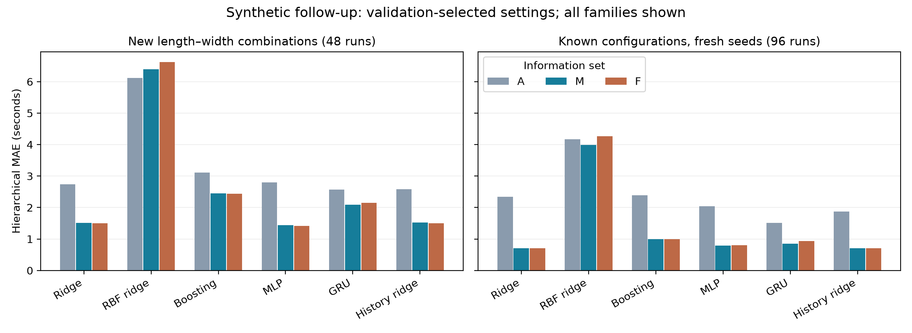

# Mobility & Relationship Information for Clearance Forecasting


**Do family and assistance relationships improve clearance-time predictions once individual mobility is known?**

Research artifacts for *Mobility and Relationship Information for Single-Lane Clearance Forecasting: An Exploratory Simulation Study*, developed for Research Methodology at RV University.

[Paper source](paper/compound/conference_8page/main.tex) · [Original protocol](research/compound/prediction_protocol_v1.md) · [Broader comparison](output/compound/broad_prediction_001/report.md) · [SiME replay](output/sime_replay_v2/report.md) · [Reproduce the results](#reproduce-the-results)



## What this project tests

The same observed movement is represented with three information sets:

- **A — Aggregate:** crowd counts, observed motion, exit distances and geometry.
- **M — Mobility:** A plus an exact nominal mobility roster, including profile and speed summaries.
- **F — Relationships:** M plus supplied family and helper–wheelchair link summaries.

The simulator keeps wheelchair users and helpers as separately counted occupants while reserving a shared compound footprint. Parent–child relationships impose a shared pace. Comparisons use matched conditions, causal observation cutoffs and blockwise partitions.

## Main findings

| Evaluation | A MAE | M MAE | F MAE |
| --- | ---: | ---: | ---: |
| Original held-out configurations | 2.660 s | **1.222 s** | 2.397 s |
| Follow-up: new configurations | 2.584 s | **1.437 s** | 1.500 s |
| Follow-up: known configurations, fresh seeds | 1.877 s | 0.785 s | **0.705 s** |

Original mobility error is 54.0% lower than the aggregate reference. The anticipated additional relationship advantage is unsupported in that experiment. The follow-up compares ridge, RBF ridge, boosting, MLP, GRU and history ridge. Its reported systems are selected using validation data, before fresh test generation. Both selected M-minus-F conditional intervals span zero: **the follow-up leaves incremental relationship value inconclusive**.

The experiments use different development partitions. Their scores cannot isolate an architecture effect. Three candidate settings per family are a bounded search, not exhaustive optimisation.

### Three evidence layers

1. **Movement verification:** 28 scenario checks, 21 stability comparisons and seven software checks on declared limiting cases.
2. **Synthetic prediction:** 240 original trajectories / 720 queries, followed by 144 fresh trajectories / 432 queries. The original frozen sources and outputs are preserved.
3. **Separate empirical reference replay:** a JuPedSim unassisted model under observed SiME inflows. Equal-trial individual crossing MAE is 4.736 s versus 13.576 s for a no-interaction free-flight reference.

**The SiME replay does not validate the rigid assistance simulator or the A/M/F forecasts.** It supplies recorded future inlet arrivals, so it is conditional replay rather than an end-to-end evacuation forecast. Capability ranges are synthetic assumptions; real assistance effects, demographic realism and operational safety remain unvalidated.

## Reproduce the results

### 1. Verify the published artifact — no installation needed

Python 3.12 is recommended. Run from the repository root:

```bash
python scripts/verify_artifact.py
```

This uses only the Python standard library. It checks the publication file hashes, the original freezes, and independent hierarchical MAE calculations for all 36 broader-comparison metric groups. It does not fit models or download data.

### 2. Install the analysis environment

```bash
python -m venv .venv
# Activate .venv using the command for your operating system.
python -m pip install -r requirements.txt
```

The recorded neural runtime is CPU PyTorch 2.7.1. On a machine where pip selects a CUDA build, install its CPU wheel from the official PyTorch index instead. Exact versions used in the study are pinned in the requirements files. No GPU or model download is required for the experiment itself.

### 3. Run checks and reproduce selected predictions

```bash
python -m unittest discover -s tests_compound -v
python -m research.compound.audit_comparisons
python -m research.compound.reproduce_selected
python -m research.compound.run_broad_prediction evaluate
python -m research.compound.audit_broad_prediction
```

The original audit verifies 240 saved trajectories and recomputes metrics. Original selected-model reproduction refits only the already-selected settings. Follow-up evaluation uses the 18 saved models; its fresh-process audit independently checks predictions and MAEs. Some audit/report commands rewrite derived audit files, so the immutable publication manifest is best checked on a clean checkout before running them. Numerical differences can occur on other software/hardware stacks.

### 4. Inspect or regenerate figures

```bash
python -m research.compound.plot_comparisons
python -m research.compound.report_broad_prediction
```

Use a fresh copy for research extensions. The archived `train`, `generate` and original production entry points deliberately reject or preserve existing frozen attempts. Do not overwrite protocols or delete a freeze to reuse reported tests for model selection. The simplest reproducible path is the saved-output and fixed-model evaluation above.

### 5. Optional: replay SiME from its original release

```bash
python scripts/fetch_sime.py
python scripts/replay_sime.py
python -m research.compound.report_sime_replay
```

The fetcher obtains metadata and four required trials from the original host, checking recorded hashes/ZIP CRCs. The replay evaluates the already-frozen parameters; it does not select new parameters. Raw human trajectories and participant-level replay records are not redistributed in this repository. Aggregate summaries and calibration traces are included. See [data provenance](data/README.md) before acquiring the original data.

## Repository guide

```text
src/compound/                  Compound-footprint simulator and original study
src/broad_prediction.py        Six learner families and causal histories
src/sime_replay.py             Separate observed-inflow reference model
tests_compound/                Movement, feature and replay contract checks
research/compound/             Frozen protocols, runners, reports and audits
research/literature/           Revised 18-source selection and historical records
output/compound/               Saved synthetic trajectories, models and results
output/sime_replay_v2/         Aggregate empirical replay evidence
paper/compound/conference_8page/ Current course manuscript and figures
scripts/                      Artifact verification and optional data acquisition
data/                         External-data provenance and archive index
ARTIFACT_MANIFEST.json         File-level SHA256 publication snapshot
```

The paper uses the seven prescribed course sections. Compile `paper/compound/conference_8page/main.tex` with an IEEEtran-compatible TeX distribution, keeping its `images/` directory alongside it. The TeX file is self-contained apart from figures; `body.tex` is an assembly helper, not another submission. Existing machine-specific PDF exports, slide drafts, installed dependencies and scratch outputs are intentionally absent.

## Literature and interpretation

The final course bibliography has **18 sources**, comprising nine retained original-review sources and nine directly used modelling, data, software or statistical references. This is a documented post-experiment relevance revision, **not a reconstruction of unavailable historical PRISMA screening counts**. Methods/documentation are not relabelled as empirical mobility studies. See the [selection record](research/literature/revised_course_review_18.md).

Conditional intervals resample matched blocks within fixed configurations while holding fitted models fixed. They exclude fitting, selection, generator and population uncertainty. These artifacts support internal computational repeatability; they do not establish independent researcher replication, a novel learning algorithm or indexed-publication acceptance.

## Authors, attribution and reuse

Surya Maheswaran · Yashaswini Pawar · Sohan Kori · Seema B. Hegde

No external funding was received. AI assistance supported coding, analysis and manuscript preparation; authors retain responsibility for verification. No new participants were recruited. Institutional requirements for reuse of public de-identified data remain an author responsibility.

External data, JuPedSim, scikit-learn, PyTorch and the other dependencies retain their original terms. The SiME dataset and accompanying study must be cited separately. A project-wide reuse licence has not been selected by all authors; public visibility alone does not grant an open-source licence. `CITATION.cff` provides citation metadata for this research artifact.
