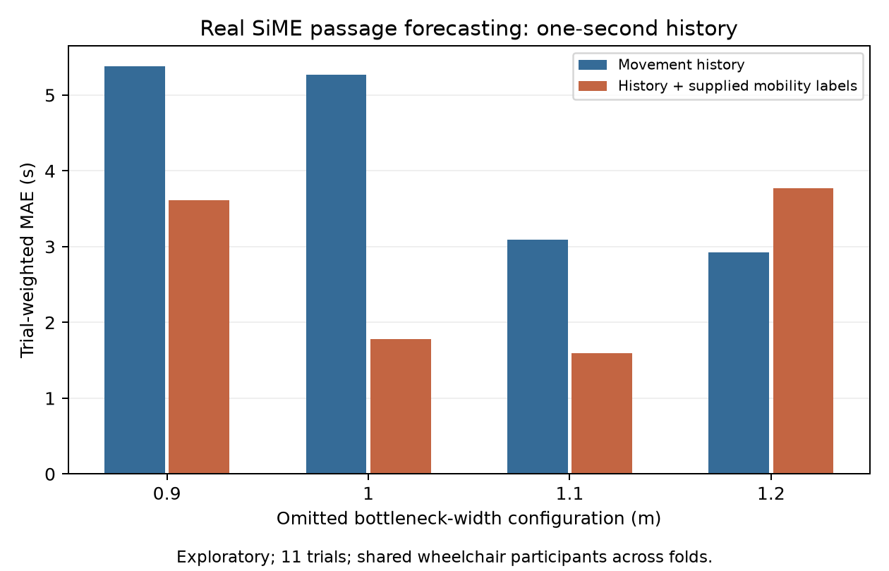

# Crowd Clearance Forecasting

**Do mobility information and assistance relationships improve forecasts beyond observed movement?**

A Research Methodology project at RV University combining recorded SiME bottleneck trajectories with a separate JuPedSim assistance-link experiment.

[Current paper](paper/real_and_linkage/main.tex) · [Empirical results](output/empirical_comparison_v1/report.md) · [Assistance-link results](output/linkage_benchmark_v1/report.md) · [Research plan](plan.md)

## Current paper

*Mobility and Assistance-Link Information for Crowd Passage-Time Forecasting: An Exploratory Empirical and Simulation Study*

Surya Maheswaran, Yashaswini Pawar, Sohan Kori and Seema B. Hegde.

The IEEE-style course draft has seven pages, 18 cited references and the seven required course sections. Compile `paper/real_and_linkage/main.tex` with its supporting `images/` folder. Author declarations and data-use requirements still need confirmation before submission.

## Findings

- **Recorded SiME data:** supplied wheelchair information reduced primary one-second-history MAE from **4.278 s to 2.591 s** across eleven selected trials. Seven wheelchair users repeat across configurations; this is exploratory configuration transfer within a shared population.
- **Label quality:** artificial label flips sharply worsened predictions. Supplied labels are not a tested recognition system. [Report](output/label_sensitivity_v1/report.md)
- **Composition:** crowd-condition information explains part of the predictive benefit; this does not isolate a causal individual-mobility effect. [Report](output/composition_check_v1/report.md)
- **Separate synthetic benchmark:** at zero assumed assistance speed gain, mobility/history MAE was **0.198 s** and correct-link MAE **0.208 s**. Correct assignments showed no consistent advantage over mobility/history, counts and shuffled controls. Negative results are retained.



The empirical target is the last downstream **head-centre passage of an observed cohort**. The synthetic target is the last **full-circle exit of a known roster**. Their errors cannot be pooled. The circular-agent escort prototype does not represent mechanical wheelchair pushing. Numerical checks do not establish behavioural realism or operational evacuation safety.

## Repository guide

- `paper/real_and_linkage/`: active manuscript, figure and guideline audit.
- `research/`: modelling, saved-output audits and protocols.
- `research/assistance/`: JuPedSim escort controller, frozen benchmark and audits.
- `research/data/forecast_bundle/`: aggregate model inputs and manifest.
- `research/literature/`: scoped searches, evidence status and reference checks.
- Current result folders: `output/empirical_comparison_v1/`, `output/label_sensitivity_v1/`, `output/composition_check_v1/` and `output/linkage_benchmark_v1/`.
- `requirements.txt`: one dependency file for the current study.

The private repository also retains the **historical compound study** under `src/`, `scripts/`, `tests_compound/`, `research/compound/`, `research/recovery/`, `paper/compound/`, `output/compound/` and `output/sime_replay_v2/`. Those results and environments are separate from the current manuscript. Historical dependency pins are available in Git history before this update. Other older literature records remain historical.

## Inspect and reproduce

Python 3.12 is recommended. From the repository root:

```bash
python -m venv .venv
# Activate the environment for your operating system.
python -m pip install -r requirements.txt
```

Reconstruct saved comparisons:

```bash
python research/audit_empirical_comparison.py
python research/audit_label_sensitivity.py
python research/audit_composition_check.py
python research/assistance/audit_linkage.py
```

These audits read saved inputs/predictions and rewrite derived metric/audit files. They do not retrain models. Aggregate empirical inputs support saved-output reconstruction; rebuilding features requires obtaining the original SiME release and configuring local source paths. Some extraction scripts refer to the original local backup, which is intentionally not distributed.

The synthetic study includes 192 main runs and 48 finer replays from 48 matched blocks. Frozen generation/fitting commands deliberately reject existing admission/prediction outputs. Use a separate experimental copy for extensions and preserve the recorded protocol; do not delete a freeze to retune on reported evaluation data.

## Data and access

SiME source: [Influence of individual characteristics](https://doi.org/10.34735/ped.2017.1). Credit remains with its investigators. Raw human trajectories and participant mappings are not mirrored. Backups, dependencies, temporary files and stale PDF exports are excluded from this update. No redistribution licence or new ethics exemption is inferred.

This repository remains **private**. This is an exploratory research artifact, not a validated crowd-safety product or an accepted publication.
