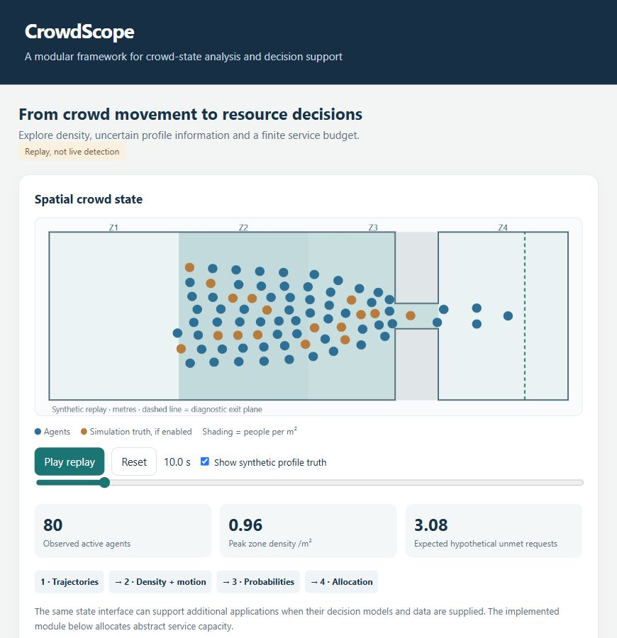

# CrowdScope

### A modular framework for crowd-state analysis and uncertainty-aware resource planning

**Trajectories → spatial crowd state → uncertain composition → explicit decisions.**

[Paper PDF](paper/framework/CrowdScope_Paper.pdf) · [LaTeX source](paper/framework/main.tex) · [Demo guide](app/README.md) · [Final results](research/final_evaluation_A1_report.md)



A Research Methodology project at RV University by **Surya Maheswaran, Yashaswini Pawar, Sohan Kori and Seema B. Hegde**.

CrowdScope connects geometry-aware density measurement, causal movement summaries, conditional probabilities and finite-capacity allocation through a common crowd-state interface. New applications can consume that state when their decision models and validation data are supplied. The evaluated decision module is static allocation of abstract support capacity. CCTV, automatic wheelchair/child recognition, dynamic dispatch and reliable evacuation timing remain extensions.

## Implemented modules

- **Observe:** canonical trajectories, explicit units and track-quality checks.
- **Measure:** polygon/obstacle-aware counts, density, past-only motion and crossings.
- **Estimate:** conditional probabilities, expected composition and count distributions.
- **Decide:** exact allocation with population, hard-label, probability and information-reference controls.
- **Audit:** fixed configurations, grouped partitions, paired uncertainty and negative controls.
- **Demonstrate:** an offline synthetic replay with interactive assumptions and decisions.

## Paper and evidence

**CrowdScope: A Modular Framework for Crowd-State Analysis and Uncertainty-Aware Resource Planning**

The IEEE-style course paper has **seven pages, eighteen references and seven required major sections**.

- Recorded SiME trajectories integrate at **42 checkpoints from fourteen trials**. This verifies occupancy processing, not real profile recognition or service demand.
- The fixed synthetic evaluation covers **60 independent seed blocks, fourteen conditions and 58,800 policy records**.
- Probabilities reduce base unmet requests by **0.255** versus hard posterior, paired 95% interval **[−0.390, −0.127]**. The paper identifies that comparator's threshold weakness.
- Against hard observed labels, base allocations match in **599/600 replicas**, with no probability advantage. Small secondary gains depend on zone balance and demand contrast.
- Dense-crowd jams and timestep sensitivity remain in the JuPedSim record. No general evacuation or safety validation is claimed.

[Full interpretation and limitations](research/final_evaluation_A1_report.md). Established mathematical tools support a transparent information-to-decision benchmark; no invented Bayesian algorithm or verified first-framework claim is made.

## Try the demo

```bash
python app/launch.py
```

Or open `app/index.html` directly. No external service is needed. Play/scrub the crowd replay; adjust budget, assumed prevalence, assumed error and policy. Optional colours show simulation truth, not recognised disability. Each unit serves two hypothetical requests. [Demo details](app/README.md).

## Reproduce

Python 3.12 is recommended. Core planning uses the standard library; geometry, simulation and figures use the single root requirements file.

```bash
python -m venv .venv
# Activate the environment for your operating system, then:
python -m pip install -r requirements.txt
python -m unittest discover -s tests
python research/audit_planning_evaluation.py
python research/analyse_evaluation_A1.py
```

The guard denies evaluation by default. The dated release permits the fixed final run. Saved experiment folders refuse overwrite: regenerate in a clean source/configuration copy without that experiment's pre-existing output folder.

```bash
python research/run_planning_manifest.py --partition evaluation --enable-evaluation
```

The release binds original source/configuration bytes. `.gitattributes` disables line-ending conversion so hash checks remain reproducible. Analysis averages replicas within seed and uses a paired block bootstrap; frames, replicas and cells are not independent crowds.

## Build the paper

```bash
python paper/framework/make_figures.py
tectonic paper/framework/main.tex
```

The [compiled PDF](paper/framework/CrowdScope_Paper.pdf) and figures are included. Figures use aggregate results only. The paper links this private repository; reviewers need access permission.

## Repository guide

- `src/crowd_state.py`, `polygon_zones.py`: observed state and geometry.
- `src/mobility_probability.py`, `resource_planning.py`: uncertainty and allocation.
- `app/`: self-contained demonstration and launcher.
- `configs/`, `research/evaluation_*`: design, partitions and release record.
- `output/planning_evaluation_A1/`: synthetic outcomes, analysis and audit.
- `research/literature/`: scoped evidence and closest-method comparison.
- `paper/framework/`: current manuscript and verification record.

## Data boundaries

The final benchmark and demo are synthetic. Raw SiME tracks, identity registries and derived participant-level integration/replay files are excluded from this update pending confirmation of redistribution terms. Aggregate summaries are included where appropriate.

Raw-data audit/replay scripts require the local verified archives documented in `plan.md`; those archives are not uploaded. A fresh clone reproduces synthetic planning and its audits but needs separately acquired source data to reproduce raw-data measurements. Hypothetical profiles and request rates are not real demographic or staffing labels.

## History

Earlier studies remain under `paper/real_and_linkage/`, `paper/compound/`, `research/compound/`, `research/assistance/` and related historical source/output folders. Their targets, environments and results differ from CrowdScope. Current entry points are listed above; historical dependency pins remain in Git history.

No external funding was received. Third-party data retain their source terms; no new blanket licence is asserted. Author and venue declarations need confirmation before formal submission.
