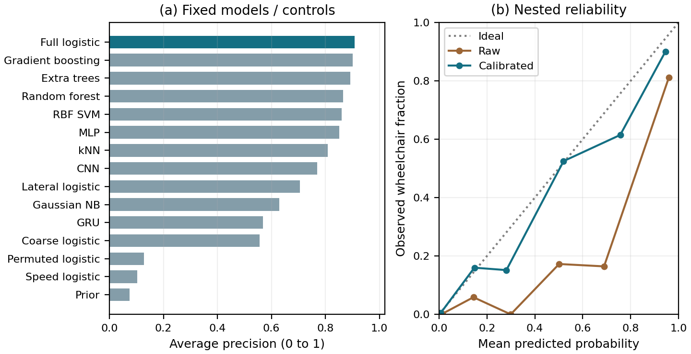

# CrowdScope

### Trajectory-based crowd analysis with calibrated mobility estimates

**Observe movement → measure crowd state → estimate composition → explore decisions.**

CrowdScope is a Research Methodology project at RV University. It connects
geometry-aware occupancy and density, past-only movement features, an exploratory
wheelchair-associated motion detector, calibrated probabilities, and a configurable
resource-planning example.

[Read the paper](paper/framework/CrowdScope_Paper.pdf) ·
[LaTeX source](paper/framework/main.tex) ·
[Framework guide](docs/calibrated_framework.md) ·
[Results and limitations](research/calibrated_framework_results_v1.md)

## Quick start

Python 3.12 is recommended. The browser demonstrations need only Python's standard
library; no account, external service or model download is required to view them.

```bash
git clone https://github.com/surya070/crowdscope.git
cd crowdscope
python app/launch.py --page framework.html
```

Open the localhost address printed by the launcher.

- **Framework page:** shows the recorded eight-trial replay when its local data
  package is available; a clean checkout shows the included aggregate evidence
  and usage guide.
- **Self-contained synthetic demo:** run `python app/launch.py --page index.html`.
  Play the replay and change information assumptions, budgets and capacity.
  Its colours represent synthetic truth, not actual recognition.

The repository is **private**; cloning and reviewing require access permission.
The recorded human replay and fitted recognition weights are not bundled.

## What the framework does

1. **Ingest:** timestamped person positions and walkable geometry, with explicit units.
2. **Measure:** zone counts, usable area, density, recent speed and observation coverage.
3. **Estimate:** calibrated wheelchair-associated probabilities, flagged prior
   fallback, expected zone composition and working count intervals.
4. **Explore:** allocate limited hypothetical service capacity under declared
   request-rate assumptions.
5. **Audit:** retain input hashes, group-aware splits, metric checks and negative findings.

Users define observation zones and supply canonical CSV or streaming input. New
management applications can consume the crowd-state interface, but need their own
decision models and validation. See the [input schema and API guide](docs/calibrated_framework.md).

## Evidence at a glance

- **Eight SiME trials; 711 eligible movement windows.** The 55 positive observations
  represent **seven repeated wheelchair participants**, not 55 independent people.
- **Fifteen fixed models/controls**, including MLP, temporal CNN and GRU. Full
  logistic has the highest observed exploratory AP (**0.907**); close model scores
  do not establish statistically meaningful superiority. AP is not accuracy.
- **Nested person/trial calibration:** Brier loss **0.0362 → 0.0210**; precision
  **84.3%**, recall **83.6%** at the preset threshold.
- **Separate whole-trial replay:** nonempty-zone count MAE **0.602 → 0.452 people**.
  Participants may recur between training and test in this evaluation.
- **No improvement in default hypothetical resource-planning loss.** Better
  composition estimates do not automatically produce better decisions.
- **46 tests**, detector/calibration audits and 100 Python/JavaScript planner
  comparisons passed for the published study.



The current IEEE-style paper has **seven pages and eighteen references**.
Recognition remains exploratory and specific to the studied trajectories. Only
21.5% of visible occupants, on average across nonempty replay checkpoints, have
detector evidence; the others retain flagged priors. Child/age recognition,
arbitrary-scene transfer, real service demand and reliable evacuation forecasting
are not established.

## Install and verify

Install the single dependency file for research scripts and model training:

```bash
python -m venv .venv
# Activate the environment for your operating system, then:
python -m pip install -r requirements.txt
python -m unittest discover -s tests
```

Synthetic planning outputs can be audited with
`python research/audit_planning_evaluation.py`. Recognition/calibration audits and
retraining require the separately obtained source data and local result files;
see the [rebuild guide](docs/calibrated_framework.md). Frozen experiments refuse
accidental overwrites, and source-byte hashes must remain intact.

To regenerate aggregate paper figures and compile the manuscript:

```bash
python paper/framework/make_figures.py
tectonic paper/framework/main.tex
```

## Repository layout

- `src/` — crowd measurements, calibrated inference and planning API.
- `app/` — framework evidence/replay interface and self-contained synthetic demo.
- `docs/` — usage, input format and data prerequisites.
- `paper/framework/` — current manuscript, figures and compiled PDF.
- `research/results/` — aggregate recognition and calibration results.
- `research/` — protocols, evaluation scripts and research reports.
- `configs/`, `output/planning_*` — earlier controlled planning designs and outputs.
- `tests/` — current automated checks.

## Data, privacy and earlier work

Raw SiME trajectories, identity registries, per-person predictions, fitted
recognition weights, local replay packages, dependencies and backups are excluded.
Aggregate evidence is included. External data retain their source terms; no
blanket project-wide data licence or new consent is asserted. Predicted membership
is not confirmed disability or a request for assistance.

Older compound-clearance, assistance-linkage and replay experiments remain under
`paper/compound/`, `paper/real_and_linkage/`, `research/compound/`,
`research/assistance/` and related output folders. They are historical evidence,
not the current entry points. See [publication notes](PUBLICATION_NOTES.md) and
[external-data provenance](data/README.md) for the distinction.

**Authors:** Surya Maheswaran, Yashaswini Pawar, Sohan Kori and Dr. Seema B Hegde.
No external funding was received.
