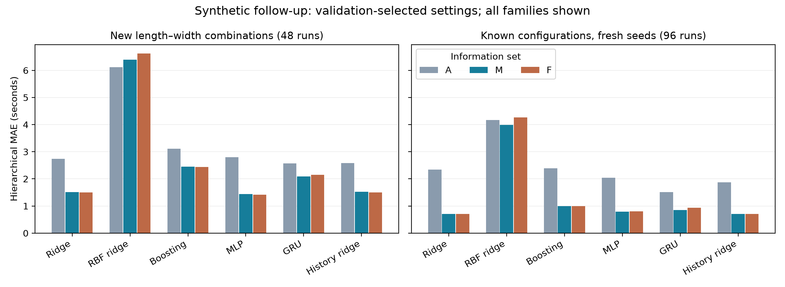

# Broader prediction comparison: completed exploratory follow-up

This extends the learning comparison, not the empirical validity of the generator. A uses aggregate motion; M adds the known nominal mobility roster; F adds supplied family and assistance links. The original 240-run study and its negative primary result remain unchanged.

Validation selected A: History ridge, M: MLP, F: Ridge. On the new configurations, MAE was A 2.584 s, M 1.437 s and F 1.500 s. The selected M-minus-F contrast was -0.063 s, conditional descriptive 95% interval [-0.380, +0.219] s. Positive contrasts favour F.

## Design and protection against test reuse

The already-inspected 192 original main trajectories became development data: 128 fitting and 64 validation runs, split by complete four-condition matched blocks across G1–G4. Three candidate settings were evaluated per family and information set (54 candidates). Settings and 18 fitted models were frozen before generating any of the 144 fresh test trajectories.

The primary test comprises 48 runs/12 matched blocks on G5 (24 m, 1.05 m) and G6 (28 m, 1.15 m). The secondary test comprises 96 runs/24 blocks on G1–G4 under fresh seeds. All 432 queries and all 144 completed runs were retained. The two new configurations change length/width, not route topology.

Static ridge, RBF ridge, gradient boosting and MLP see the same last causal vector. GRU and history ridge receive nine causal vectors over 1.6 seconds. History ridge controls for additional history. MLP and GRU each average three fixed initialisations. All models use identical train/validation partitions and hierarchical sample weights; search counts are equal within each A/M/F family, not equal runtime budgets across families.

## Complete results

### New configurations: primary follow-up

| Learner | A MAE (s) | M MAE (s) | F MAE (s) | M minus F (s) | Conditional 95% interval (s) |
|---|---:|---:|---:|---:|---|
| Ridge | 2.734 | 1.514 | 1.500 | +0.014 | [-0.039, +0.080] |
| RBF ridge | 6.123 | 6.395 | 6.621 | -0.226 | [-0.351, -0.109] |
| Boosting | 3.114 | 2.445 | 2.439 | +0.005 | [-0.022, +0.039] |
| MLP | 2.795 | 1.437 | 1.417 | +0.020 | [-0.301, +0.343] |
| GRU | 2.566 | 2.087 | 2.144 | -0.057 | [-0.305, +0.211] |
| History ridge | 2.584 | 1.529 | 1.498 | +0.031 | [-0.025, +0.094] |
| Validation-selected family per information set | 2.584 | 1.437 | 1.500 | -0.063 | [-0.380, +0.219] |

### Known configurations with fresh seeds: secondary

| Learner | A MAE (s) | M MAE (s) | F MAE (s) | M minus F (s) | Conditional 95% interval (s) |
|---|---:|---:|---:|---:|---|
| Ridge | 2.341 | 0.703 | 0.705 | -0.002 | [-0.037, +0.034] |
| RBF ridge | 4.174 | 3.986 | 4.267 | -0.281 | [-0.339, -0.226] |
| Boosting | 2.386 | 0.991 | 0.998 | -0.007 | [-0.018, +0.006] |
| MLP | 2.037 | 0.785 | 0.798 | -0.013 | [-0.085, +0.056] |
| GRU | 1.516 | 0.854 | 0.938 | -0.084 | [-0.226, +0.047] |
| History ridge | 1.877 | 0.701 | 0.708 | -0.007 | [-0.043, +0.028] |
| Validation-selected family per information set | 1.877 | 0.785 | 0.705 | +0.081 | [-0.100, +0.270] |

## Selection and audit

| Family | Information | Selected setting | Validation MAE (s) |
|---|---|---|---:|
| Ridge | A | {"alpha": 0.01} | 1.513473 |
| Ridge | M | {"alpha": 0.01} | 0.724701 |
| Ridge | F | {"alpha": 0.01} | 0.719490 |
| RBF ridge | A | {"alpha": 0.1, "length": 1.0} | 3.017400 |
| RBF ridge | M | {"alpha": 0.1, "length": 1.0} | 3.052758 |
| RBF ridge | F | {"alpha": 0.1, "length": 1.0} | 3.322422 |
| Boosting | A | {"depth": 2} | 1.692541 |
| Boosting | M | {"depth": 1} | 0.896297 |
| Boosting | F | {"depth": 1} | 0.900696 |
| MLP | A | {"width": 32} | 1.559788 |
| MLP | M | {"width": 64} | 0.717224 |
| MLP | F | {"width": 64} | 0.893135 |
| GRU | A | {"width": 32} | 1.679039 |
| GRU | M | {"width": 32} | 1.049045 |
| GRU | F | {"width": 32} | 1.006806 |
| History ridge | A | {"alpha": 0.01} | 1.317375 |
| History ridge | M | {"alpha": 0.1} | 0.782612 |
| History ridge | F | {"alpha": 0.1} | 0.774500 |

Independent standard-library MAE calculations agreed within 8.9e-16 s. Fresh-process predictions from all 18 saved models agreed within 0 s. Source, fitted-model and trajectory hashes passed. Static/history endpoints matched, and removing future frames and hidden outcomes did not alter the tested input prefix. Full metrics, candidate traces and predictions are saved alongside this report.

## Interpretation and limitations

No family-matched comparison produced a conditional interval wholly favouring F. Several families had small favourable point estimates on the new configurations, but these were uncertain and did not consistently recur on the fresh-seed test. The validation-selected F was slightly worse on the new configurations and slightly better on the secondary set; both selected-system intervals spanned zero. These findings support a mixed/inconclusive incremental relationship result rather than a demonstrated benefit. GRU and boosting did not consistently outperform the simpler references in this bounded search.

This follow-up addresses the narrow concern that results depended only on ridge. Any improvement is conditional on this synthetic generator, exact nominal capabilities and supplied links. It does not establish realistic assistance gains, infer ages or relationships, or validate real evacuation times. The SiME replay remains a separate unassisted reference-model test. The expanded development set differs from the original study, so scores from the two studies cannot isolate a learner effect.

Intervals resample matched blocks within fixed configurations and keep the selected models fixed. They exclude training, selection, generator and real-population uncertainty; the exploratory contrasts are not multiplicity-adjusted. Three settings and small neural architectures are a bounded benchmark, not exhaustive tuning or proof of universal superiority. New human data with mapped helper and mobility roles remain the main empirical need.

## Reproduction

Use the saved models for evaluation; do not retrain or overwrite the freeze. Project-local sklearn 1.7.2, joblib 1.5.2, threadpoolctl 3.6.0 and mpmath 1.3.0 accompany the existing CPU PyTorch runtime. Run `research/compound/run_broad_prediction.py evaluate`, then `research/compound/audit_broad_prediction.py` and this report generator with the project root and local dependency folders on PYTHONPATH. `train` refuses an existing model freeze.
